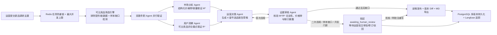

# 跨境电商多 Agent 选品调研与人工审批工作台 (`ecom-selection-multiagent-studio`)

> 面向跨境电商选品运营与产品经理，围绕宠物用品上架前竞品调研、差评痛点挖掘与定位立项评审，实现 **可比竞品筛选 → 市场 & 用户洞察双 Agent 并行取证 → 运营决策草稿 → 证据审核拦截重写 → Human-in-the-Loop 人工审批挂起恢复 → 多版本 Diff 对比与 Markdown 导出** 完整闭环。

## 架构总览



## 实测量化评测结果（DeepSeek + VM PostgreSQL + VM Redis + Langfuse）

详细报告见 [`evals/reports/selection_eval_report.md`](evals/reports/selection_eval_report.md)。

| 验证维度 | 实测结果 | 结论 |
| :--- | :--- | :--- |
| **配件与脏条目过滤** | 饮水机类目入选 4 款主商品，排除 3 款配件/缺规格脏条目 | **100% 精准隔离** |
| **双路专职 Agent 并行加速** | 串行 `5106 ms` → 并行 `2217 ms` | **降延 56.6%** |
| **证据审核拦截与自动重写** | V1 拦截 4 项违规（伪造引用 + $999 幻觉报价）→ 自动重写 1 次 V2 通过（Diff 59 行） | **100% 闭环自修复** |
| **样本缺口自动触发 HITL 审批** | 烘干箱（仅 1 款竞品）自动挂起 → 运营批注修订恢复定稿（2 版 Diff 9 行） | **100% 挂起恢复闭环** |
| **Redis 任务防重复提交** | 同主题进行中二次提交精准拦截并返回已有任务 ID | **100% 防重省算力** |

## 快速启动

```bash
# 1. 启动纯中文选品调研与审批工作台（http://127.0.0.1:8002）
.venv/Scripts/uvicorn.exe ecom_selection.api:app --host 127.0.0.1 --port 8002

# 2. 运行离线单元测试与多 Agent 端到端评测
.venv/Scripts/pytest.exe -v
.venv/Scripts/python.exe evals/run_selection_eval.py
```
